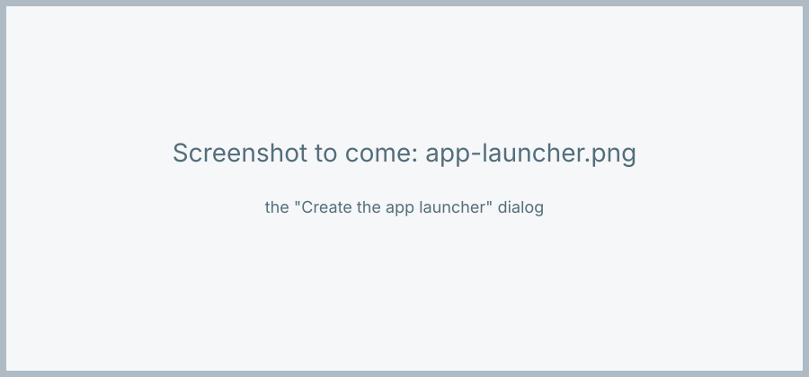

# DomotiQGIS as an app

DomotiQGIS can start like an app of its own: a desktop shortcut opens QGIS in a
**profile of its own**, with the [robot project](first-steps.md#the-robot-project),
the robot on the map and the DomotiQGIS panel. QGIS's other toolbars and panels are
hidden. Your usual QGIS, its plugins and settings are not changed.

It is still QGIS underneath: QGIS must be installed, and it starts as fast as QGIS.

## Create the launcher

*Plugins › DomotiQGIS › Create the app launcher…*:

- **Robot project**: the project the app opens (the robot project of the settings,
  else the current one).
- **Profile**: the QGIS profile of the app, `DomotiQGIS` by default.
- **Copy the settings**: servers, options and room groups, as they are now.
- **Copy the tokens and passwords**: QGIS's authentication database, when the
  app's profile has none yet. It holds all your QGIS authentication settings, not
  only DomotiQGIS's.
- **Shortcut on the desktop** and **Entry in the applications menu**.

!!! note "The master password"
    With the tokens and passwords copied, the app's first start asks for QGIS's
    **master password**: the same as in your usual QGIS. Tick *Store/update the
    master password in your Wallet/KeyRing* so that it is not asked again.



What it creates:

| | |
|---|---|
| Profile | `…/QGIS3/profiles/DomotiQGIS/`, with the plugin enabled in it |
| Plugin | a link to the plugin of your usual profile, so that it stays up to date (a copy where a link is not possible: then run the command again after updating the plugin) |
| Linux | `DomotiQGIS` launchers (`.desktop`) on the desktop and in `~/.local/share/applications` |
| Windows | `DomotiQGIS` shortcuts on the desktop and in the Start menu |
| macOS | a small `DomotiQGIS.app` on the desktop and in `~/Applications` |

The launcher runs:

```
qgis --profile DomotiQGIS --profiles-path <QGIS folder> --nologo --project <robot project>
```

The app's settings are its own from then on. To copy those of your usual QGIS again,
run the command again from it.

## In the app

- Only the map, the DomotiQGIS panel and toolbar, and the map navigation toolbar
  are shown. The menus stay.
- The robot project opens and **Show on map** turns on once the robot answers.
- *Plugins › DomotiQGIS › **App mode*** (only in the app's profile): untick it to
  show QGIS's toolbars and the Layers and Browser panels again; tick it to hide them.

!!! tip "On Linux"
    Some desktops (GNOME) only run a launcher on the desktop once it is allowed:
    right-click it, *Allow Launching*. With QGIS installed as a Flatpak, the
    launcher runs `flatpak run org.qgis.qgis`.
