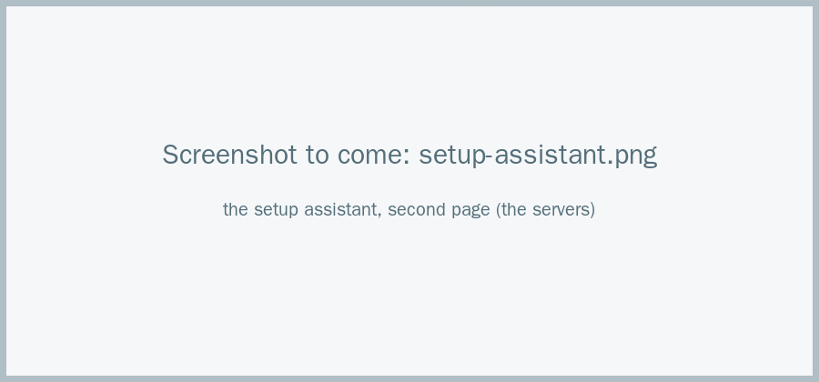
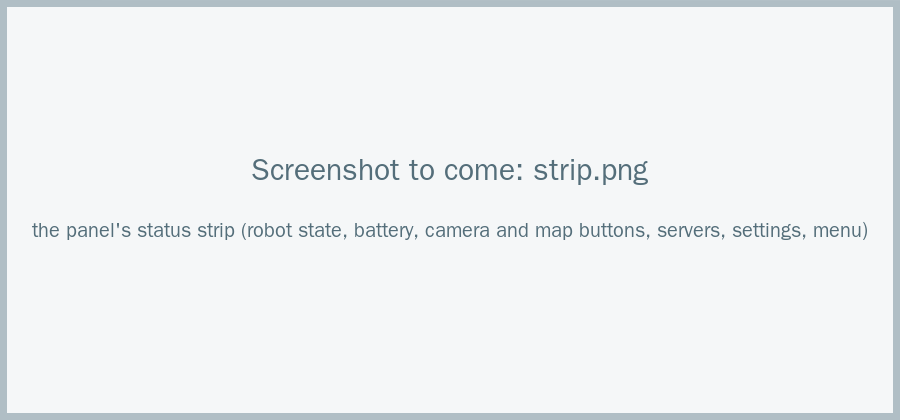

# First steps

## The setup assistant

When QGIS starts and no robot is set, a message offers **Set up…**. The assistant
(also in *Plugins › HomeQGIS › Setup assistant…*) asks:

1. **Your robot's address**, e.g. `http://192.168.1.23`, with a test.
2. **The other servers you have**: Raspberry Pi, NUC (Linux computer), Home
   Assistant, Kodi. Tick those you have and give their address.

**Finish** saves them and opens the panel. Everything can be changed later in the
settings.

## Adding the robot by hand

1. *Settings › Options › HomeQGIS* (or *Plugins › HomeQGIS › Settings…*).
2. Tab **Servers**: **Add › Valetudo robot**.
3. Enter its **Address** (e.g. `http://192.168.1.23`), then **Test connection**: it
   answers with the robot's model.
4. **OK**. As on every Options page, *Cancel* saves nothing.

See [Settings › Servers](settings.md#servers) for the other server types.

## Opening the panel

Click the HomeQGIS button in the toolbar (or *Plugins › HomeQGIS ›
HomeQGIS panel*). The panel docks on the side of QGIS like any panel: drag its
title to move it, or float it in its own window.

Then click **🗺 Show on map** in the panel's status strip: the robot's map appears
in the current project, with the robot on it.

## Simple first, advanced later

A new installation hides the **advanced tools** (consoles and logs in QGIS, the
Wi-Fi recorder on the robot, the boot watch, the editing of no-go zones), so that
the first look stays simple. Turn them on in the panel's **⋮ › Advanced tools**,
or in the settings' *Robot* tab.

## The robot project

The robot's [map](map.md#saved-with-the-project), [history](robot/history.md) and
[Wi-Fi survey](robot/wifi.md) are kept in [folders next to the project](files.md),
so the plugin never loads them into a project that has never been saved.

The first time you click **🗺 Show on map** in such a project, it offers to save it
as the **robot project** (in a folder of its own, `~/HomeQGIS/robot.qgz` by
default). Once a robot project is set, it offers to open it instead. The robot
project is shown, and can be changed, in the settings' *Robot* tab, *General*.

Show on map also works in any other saved project: the robot's layers then go in
folders next to that one.
