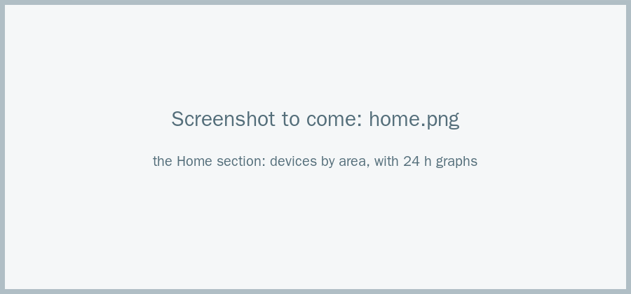
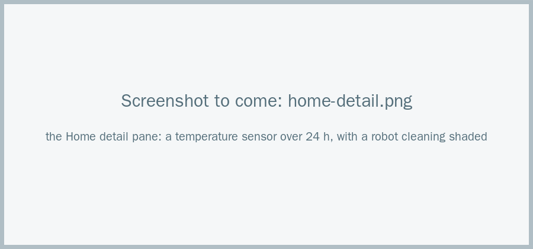

# Home (Home Assistant)

The **🏠 Home** section shows Home Assistant's devices. It needs a Home Assistant
server in the settings, with its **access token** (see
[Settings › Servers](settings.md#home-assistant)).

## The device list

Read with one request every 15 s while the section is shown (**⟳** reads again
now); the line under the list says when it was last updated. The selection and
the scroll position stay as they are, and the detail pane's graphs are read again
every minute.

- **Group by**: **area** (Home Assistant's rooms) or **integration** (Zigbee/ZHA,
  MQTT/Zigbee2MQTT, Hue, Shelly, ESPHome…).
- **Each area** shows its temperature, humidity, open doors and motion.
- **Each device**: its main values, a **24 h graph**, its battery 🔋 (with about how
  long it will last) and its Zigbee link quality 📶 (0–255). Faded when unavailable;
  battery in orange below 20 % or when it will be empty within two weeks. Unfold a
  device for all its entities.
- **⏻** switches lights, plugs and switches on or off.
- **Filter** by name, model, area or entity; **Problems only** keeps unavailable
  devices and batteries to change; **Other entities** adds Home Assistant's own
  (sun, weather, automations, helpers…).

Unavailable devices and batteries to change are also listed by the strip's ⚠.

## The detail pane

Under the list (drag the bar between them). Select a **device**, one of its
**entities**, or a whole **area**:

- **Period**: 6 h, 24 h, 7 d or 10 d (Home Assistant keeps 10 days by default).
- **Curves** for numbers (temperature, humidity, power…), with min, max and mean;
  **timelines** under them for doors, motion, lights and plugs, with how many times
  and how long.
- **🤖 The robot's cleanings** of that room, shaded on the chart, from the robot's
  [history](robot/history.md). The area and the robot's room must have the same
  name.
- **Health**: battery and about how long it will last (from the slope of its last
  10 days), link quality (mean and minimum), how many times it became unavailable.
- **Hover** the chart for the values at that moment.

## Compare

**Compare ▾** draws one curve per room for **temperature, humidity, CO₂, light
level, power** or **pressure** (the first such sensor of each area).

## ▶ Map

After a Compare, **▶ Map** colours the robot's rooms named like the Home Assistant
areas by that value, hour by hour (*Home replay* group), loads the robot's outings
of those days, and plays it all in QGIS's **Temporal Controller**: rooms warm and
cool, and the robot passes through. The robot's map must be shown.

## Export

**Export ▾** saves what the pane shows:

- **CSV file…**: time, entity, name, state, unit;
- **GeoPackage next to the project**: a table in `history/home_<date>.gpkg`, to use
  with the QGIS tools.
