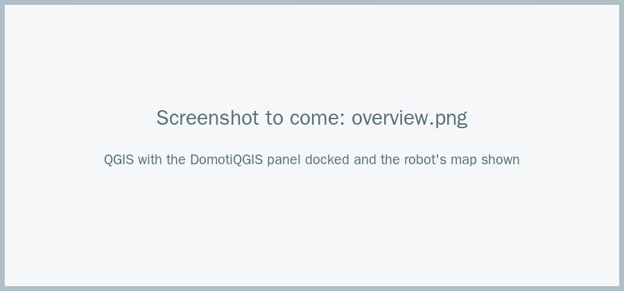

# HomeQGIS

*Domotique* + QGIS: a home control centre inside QGIS.

HomeQGIS started as a way to show and drive a [Valetudo](https://valetudo.cloud)
robot vacuum from QGIS, locally and without any cloud. It now also watches and
drives the home around it: Home Assistant and its devices, a Raspberry Pi, Linux and
Windows computers, Kodi and any web service.

## What it does

**The robot**

- Its map as real GIS layers: rooms, walls, the robot and its path, live.
- Cleaning by room, by your own room groups, by a zone drawn on the map, or *Go to*
  a point.
- Rooms renamed, joined or split, and no-go zones and virtual walls edited with the
  QGIS tools.
- Valetudo's schedule in a week view, the camera (with recording), the Wi-Fi signal
  as maps, consumables and the dock station.
- A history of every outing, one GeoPackage per day, replayed with the Temporal
  Controller.

**The home**

- Home Assistant's devices by room or by integration, with their values, battery and
  Zigbee link quality; lights and plugs switched on or off.
- Graphs from Home Assistant's history, rooms compared, and rooms coloured on the
  map as the day goes by.

**The servers**

- A frame per server with its state, clock, uptime, load, memory, disk and
  temperature.
- Its web interface, its remote desktop (VNC, RDP) and an SSH session in one click,
  and a console and a log inside QGIS.

Everything is local: the plugin talks directly to the robot, Home Assistant and
your computers. Tokens and passwords are kept encrypted in the QGIS authentication
database.

## Where to start

1. [Install the plugin](install.md).
2. [First steps](first-steps.md): add your robot and open the panel.
3. [The panel](panel.md): how it is organised.

The plugin is available in English and French: its interface follows the QGIS
language. This manual is in English.
