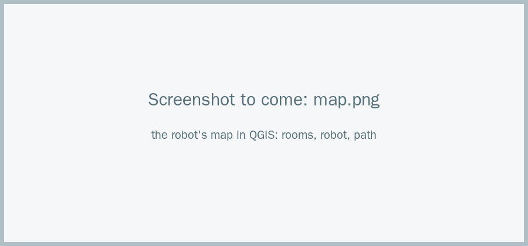

# On the map

The robot's map is shown as real QGIS layers, in the robot's own frame (in
centimetres, no CRS), in a *Valetudo* group:

| Layer | What |
|---|---|
| *Valetudo - map* | rooms, walls, floor (one colour per room, with its name) |
| *Valetudo - zones* | the robot's no-go and no-mop zones, as Valetudo shows them |
| *Valetudo - lines* | the robot's path, its predicted path, virtual walls |
| *Valetudo - robot* | the robot and its dock |
| *Valetudo - sensors* | Home Assistant sensors you placed |

## Show on map

**🗺 Show on map** (in the status strip) loads the map, refreshes the robot live and
keeps it in view, recentring only when it nears the edge. Click again to stop.

It turns on by itself when QGIS starts with an empty project and the robot answers
within a minute (settings, *Robot* tab, *General*). A project with layers is left
untouched.

While it is on:

- the **map tools** appear in the DomotiQGIS toolbar (those ticked in the settings'
  [UI configuration](settings.md#ui-configuration));
- a small **status card** (state, battery, job) sits in the map's top right corner,
  so you can follow the robot with the panel closed.

## Map tools

| Tool | What it does |
|---|---|
| { width=20 } **Pick rooms on the map** | Click a room to tick or untick it in the Clean tab; right-click it for its menu (rename, join, split). |
| { width=20 } **Place a sensor on the map** | Click a point, choose a Home Assistant sensor: it shows there with its live value. Right-click a sensor to remove it. |
| { width=20 } **Edit no-go zones and walls** | Advanced tool, see below. |
| { width=20 } **Send no-go zones and walls to robot…** | Advanced tool, see below. |

Zone and Go to tools (from the Clean tab) switch back to the Pan tool after each use.

## Sensors on the map

**Place a sensor on the map** needs the Home Assistant server's access token. It
lists Home Assistant's `sensor` and `binary_sensor` entities (temperature, humidity,
door, motion, leak…); the value is refreshed every 15 s while *Show on map* is on.
To move one, remove it and place it again. Positions are kept in the plugin's
settings, so they follow you from one project to another.

## No-go zones and virtual walls

*Edit no-go zones and walls* loads the robot's restrictions into two editable
layers: *no-go zones* (polygons, *No-go* or *No-mop*) and *virtual walls* (lines).
Edit them with the usual QGIS tools (add, move vertices, snapping, undo). A bar at
the top of the map offers **Send to robot…** (after a confirmation, they replace the
robot's restrictions) and **Discard changes**.

Valetudo needs 4 corners per zone and 2 points per wall: other shapes are converted
(bounding rectangle, line ends), and the confirmation says so.

## Saved with the project

Once the project is saved:

- the map (rooms, walls, floor) and its zones are kept in
  `map/robot_map.gpkg` next to the project, so they show when the project is reopened,
  even with the robot off;
- each version of the map (after a new mapping) is also kept as
  `map/robot_map_<map id>.gpkg`; the outings of the history carry the same map id.

The robot, its path and the sensors stay temporary layers, filled while the robot
answers. Reopening a project reuses its layers instead of adding a second set.
