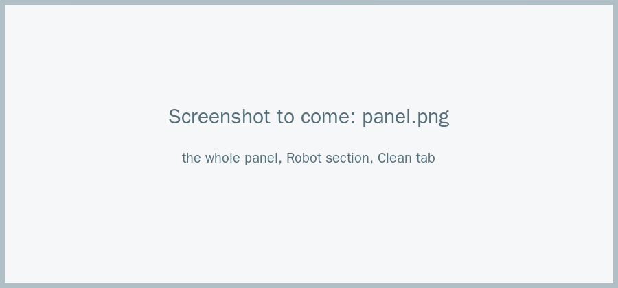

# The panel

The panel holds everything; the QGIS menu and toolbar stay minimal.

```
┌──────────────────────────────────────────────────────────────────┐
│ (logo) [Cleaning] ▮▮▮▮▯ 82 % 12 min ⚠ [📷][🗺] │ (Pi)● (HA)● … [⚙][⋮] │  status strip
├───────────────┬───────────────┬──────────────────────────────────┤
│ 🤖 Robot      │ 🏠 Home       │ 🖥 Servers                        │  sections
├──┬────────────┴───────────────┴──────────────────────────────────┤
│🧹│ Clean        rooms, groups, cleaning profile                   │  the robot's
│📅│ Schedule     week view and list                                │  side tabs
│🕘│ History      outings by day, week, month or year               │
│📷│ Camera                                                        │
│📶│ Wi-Fi        signal, surveys, maps                             │
│🔧│ Maintenance  robot, consumables, dock, statistics, events      │
├──┴───────────────────────────────────────────────────────────────┤
│ [ Start cleaning all rooms ]  [Return to dock]                   │  big button
└──────────────────────────────────────────────────────────────────┘
```



## The status strip

Always visible, at the top:

- **The robot**: its logo, its state as a coloured label (*Cleaning*, *Docked*,
  *Returning*…), the battery, and while it works the time and area of the job. On
  its dock, the label says what is going on there: a dock task first (*Docked ·
  Washing mops*, *Drying*, *Emptying*), else the charge (*Docked · Charging*,
  *Charged*). The status card over the map says the same.
- **⚠** when something needs you: a dock tank empty or full, a worn consumable, a
  robot error, a server with a wrong clock, Home Assistant devices unavailable or
  with a battery to change. Hover it for the list; click it to open the right tab.
- **📷** opens the Camera tab; **🗺 Show on map** shows the robot on the map (see
  [On the map](map.md)).
- **The servers** you ticked *Show in the status strip* for, in the order of the
  settings: their logo and *On the air* (green), *Off the air* (red),
  *Connecting…* (grey) or *No token* (orange, Home Assistant without an access
  token). The settings can show a coloured dot instead. Hover one for the details.
- **⚙** opens the settings; **⋮** holds the occasional commands: *Locate*, *Watch
  robot boot*, *Reboot robot (SSH)…*, *Settings…*, *Refresh now*, *Compact mode*,
  *Advanced tools*, *User manual*, *About…*.

The robot's Wi-Fi signal is in the strip's tooltip. **Click the strip** to open
the Status tab (Servers section).

## The sections

At the top of the panel, three sections:

| Section | What is in it |
|---|---|
| **🤖 Robot** | The robot's side tabs: [Clean](robot/clean.md), [Schedule](robot/schedule.md), [History](robot/history.md), [Camera](robot/camera.md), [Wi-Fi](robot/wifi.md), [Maintenance](robot/maintenance.md). |
| **🏠 Home** | [Home Assistant's devices](home.md), their graphs. |
| **🖥 Servers** | [A frame per server](servers.md), and the Terminal when a console or log is open. |

A section, like a side tab, gets an **orange dot** when one of the ⚠ problems
belongs to it. Each tab's page starts with its title, which stays in place while
the page scrolls. The order of the robot's side tabs is set in the settings
([UI configuration](settings.md#ui-configuration)).

## The big button

At the bottom, after the robot's state: **Start cleaning all rooms** when docked
or idle, **Pause** while it works, **Resume** when paused, and **Return to dock**
next to it while the robot is away from its dock (after a *Go to*, for example). It
can also be added to the toolbar (settings, *UI configuration*).

## Compact mode

*⋮ › Compact mode* keeps only the strip and the big button. Click the strip to
unfold or fold the rest. The panel never folds by itself.

## Advanced tools

*⋮ › Advanced tools* shows the tools a first look does without: the consoles and
logs in QGIS, the Wi-Fi recorder on the robot, the boot watch and the editing of
no-go zones. Off on a new installation.

## How often it refreshes

While the panel is visible: the robot every 5 s while it works and every 30 s
otherwise; Linux computers and Pis every 30 s; Home Assistant every minute; Kodi
every 5 s; the Home section every 15 s while it is shown. *⋮ › Refresh now* and
the Status tab's **Refresh all** read everything again at once.

Some things run even when the panel is closed: the robot's
[history](robot/history.md) and the [dock notifications](robot/maintenance.md#dock-station-notifications).
