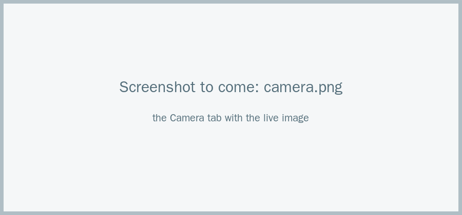

# Camera

For robots that expose a raw H.264 stream over TCP (by default
`tcp://<robot>:8555`). **📷** in the status strip opens this tab from anywhere.

- It needs **ffmpeg**, found in the `PATH` or set in the settings (*Robot* tab,
  *Camera*).
- The image starts at the robot's next full image (key frame): the first one can
  take a few seconds; the status shows how long.
- After leaving the tab, the stream keeps running for a minute, so that coming back
  is instant. It reconnects by itself if it drops.
- **Camera light**: the robot's light, when it has one.
- **Save snapshot** (or **Ctrl+Shift+S** in the tab) saves the image as PNG.
- **Full screen** shows the video in its own window (Esc or a double-click closes
  it).
- **Record** saves the video to an MP4 file (H.264) until **Stop recording**; the
  status shows the elapsed time. It records the images already decoded for the live
  view, at their size (*Video width* in the settings) and real speed, so the robot
  gets no second connection. Recording goes on after leaving the tab. The file is a
  fragmented MP4: if QGIS is killed, it stays readable up to its last seconds. Needs
  ffmpeg 5.1 or newer, with libx264.
- **Each job is recorded**: when the robot leaves its dock to clean or to go
  somewhere (a scheduled job, or one sent from the plugin, Valetudo or the app),
  the camera starts if needed and records into `videos/` next to the project
  (`valetudo_job_<date>_<time>.mp4`; while the project has never been saved: the
  folder of the last recording, else your videos folder). Untick *Record the camera
  during each job* in the settings (*Robot* tab, camera) to stop that. QGIS must be
  running with the plugin, and ffmpeg installed.
- A recording also **stops by itself when the robot is back on its dock at the end
  of its job**. A return in the middle of the job (washing the mops, clean water…;
  Valetudo says *Docked (Resumable)*) does not stop it, nor does starting a
  recording while the robot is on its dock: it stops after the robot has left and
  come back for good.
