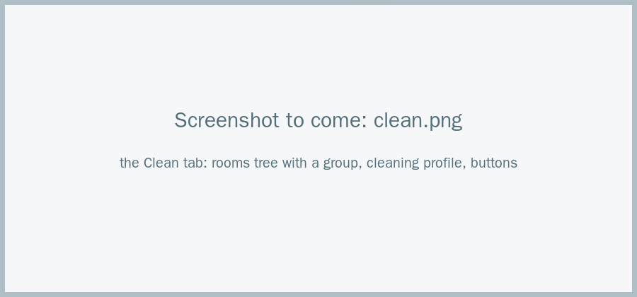

# Clean



## Rooms and room groups

Rooms are a checkable tree: **All rooms**, then your own **room groups**. Ticking
a group ticks its rooms (partly ticked when only some are). A room in several
groups is the same room: ticked everywhere, cleaned once.

Room groups are written in `valetudo_room_groups.ini`, in the QGIS profile folder.
Right-click in the tree, or *Edit room groups…* in the settings, opens it:

```ini
# one [Group] per section, one room per line (as named on the robot,
# case does not matter), or #<id>
[Water]
Kitchen
Bathroom

[Living]
Living room
Dining room
```

The panel reloads it as soon as it is saved. Names the robot does not know are
greyed out (*not found on the robot*).

## Cleaning profile

Mode (vacuum, mop or both), water usage and fan speed, as your robot offers them.
They apply at once.

## Commands

- **Clean everything** — the whole home.
- **Clean room(s)** — the ticked rooms.
- **Clean a zone…** — draw a rectangle on the map.
- **Go to…** — click a point on the map.
- **Passes** (1 to 3) — for rooms and zones.

*Clean a zone…* and *Go to…* stay pressed until you have drawn the zone or clicked
the point; they need the map shown first.

## Go to, on robots without it

Some robots (e.g. Eureka J15 Pro Ultra) have no Go to in Valetudo. The plugin then
cleans a 60 cm zone at that spot and pauses the robot as soon as it is within 50 cm.

With **Without cleaning** ticked (under the button, on by default), the plugin
first switches to the quietest settings the robot offers (vacuum only so the mops
stay up, water off, fan off or lowest), and puts yours back when the trip ends,
whatever its end. If the robot refuses a change, the trip is cancelled and nothing
is left changed. Most robots have no "fan off" in Valetudo: they still vacuum
gently on the way.

## Editing rooms

Right-click a room, in the tree or on the map (with *Pick rooms on the map*):

- **Rename…**
- **Join with ▸** another room.
- **Split with a line on the map…** — click the two ends of the cut line, from wall
  to wall (right-click or Esc cancels).

Each edit asks for a confirmation; the room list and the map are then reloaded. If
the robot refuses (e.g. a line that does not cross the room), its message is shown.
