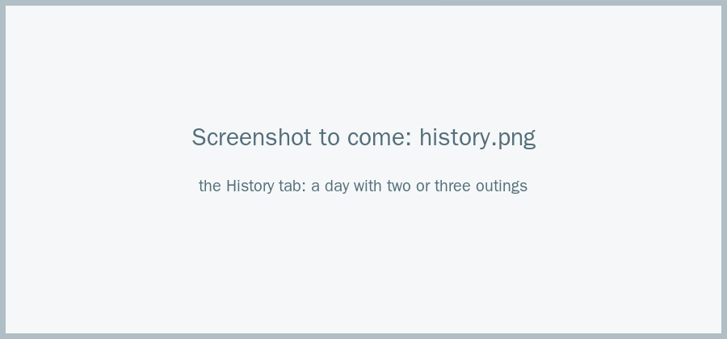

# History

Every outing of the robot, from leaving its dock to coming back, is recorded as
long as QGIS runs — panel open or not.

## What is recorded

One GeoPackage per day, `<project folder>/history/robot_YYYY-MM-DD.gpkg` (an outing
that crosses midnight stays in the file of the day it started), with three layers:

| Layer | One feature per | Main attributes |
|---|---|---|
| `outings` | outing (line) | start, end, duration, distance, activities, `job_type`, `scheduled`, rooms, area, result, `source` |
| `segments` | continuous activity within an outing (line) | `activity`, detail (rooms, zone, spot, whole home), `job_type`, `scheduled` |
| `points` | reading, about every 2 s while moving | time, `activity`, state, battery, Wi-Fi signal, `source` |

- `activity`: `cleaning`, `go_to`, `returning`, `manual`, `mapping` or `other`.
- `job_type`: `vacuum`, `mop` or `both`.
- `scheduled`: the outing started within two minutes of one of the robot's timers,
  and not from the plugin.
- Time on the dock is not recorded.

!!! note "Save the project first"
    The history folder sits next to the project. Until the project is saved, the
    outing under way is kept in memory and a message offers to save the project.

Turn it off in the settings: tab *Robot*, *History*.

## The History tab

The outings of a **day**, a **week**, a **month** or a **year** (◀ ▶, *Today*):
start (⏰ when a schedule started it), duration, activities, job, rooms, how it
ended, and the totals. A week or a month is grouped by day; a year by month, folded,
with the date in front of each outing.

- **Selecting** an outing already on the map selects it there and zooms to it.
- **Load on map** (or a double-click) adds the day, or the whole week, month or
  year (only the selected outing's day in a month or a year), under
  *Robot history › Week NN · YYYY › day*: segments coloured by activity over a light
  halo of each outing, and the points, hidden at first.
- **Replay** plays the selected outing (or the day) in QGIS's **Temporal
  Controller** in about 30 seconds: the points appear as the robot went.
- **Open folder** opens the history folder.

Layers already on the map are refreshed as new readings are written.

## Outings made while QGIS was closed

- **From the robot**: when the [Wi-Fi recorder](../extras/robot-recorder.md) is
  installed on the robot, it records the robot's position and state whenever it
  moves. Each time the plugin connects (or with **From the robot**), the outings
  QGIS did not see are added (`source` = `robot`). Those already recorded are skipped,
  and the times are corrected when the robot's clock is off. These outings have no
  job type, rooms or result: the recorder only sees the robot move.
- **From Valetudo's path**: when QGIS starts while the robot is out, or misses part
  of an outing, the outing's line is taken from Valetudo's own path of the job when
  it is longer (`source` = `live+path`).
