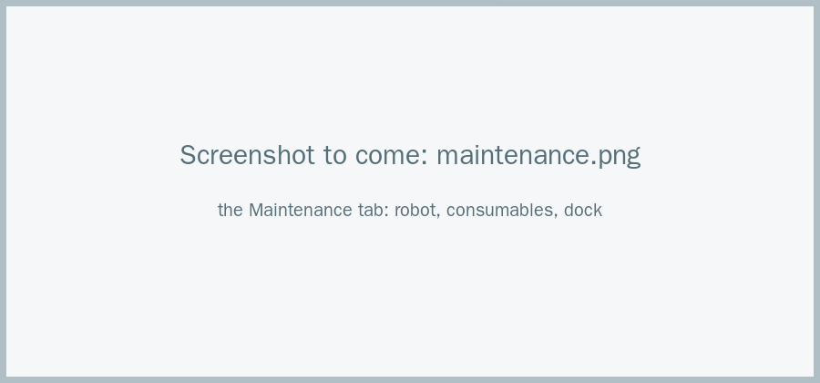

# Maintenance

The robot's details, what wears, the dock station and statistics.

- **Robot**: state, dock (what it is doing: idle, washing mops, drying, emptying,
  paused, error), attachments (mop, water tank…), position, and the system
  commands (reboot, boot watch…).
- **Robot settings** (folded at first): the robot's own settings, those it offers —
  child lock, obstacle and pet waste avoidance, carpet mode and what to do on
  carpets, mop extension and twist, mop wash water and drying time, automatic
  drying, auto-empty, cleaning route, speaker volume (with a test sound), *Do not
  disturb* hours, and the robot's *quirks* (options Valetudo describes itself, with
  its own explanation on hover). A change is sent at once; one the robot refuses
  is put back, with its reason.
- **Valetudo** (folded at first): its version, how long it has been running (and
  whether it had to restart itself), the robot's time sync, and its updates:
  *Check for updates*, then *Download* and *Install…* (asked first: Valetudo
  restarts, the robot is unreachable for a minute).
- **Consumables**: time or percentage left for brushes, filters, mops… A worn one
  shows in the ⚠.
- **Dock station**: tanks and bag, and its commands when the robot has them
  (emptying the bin, washing and drying the mops).
- **Current or last cleaning**: duration and area.
- **Totals**: number of cleanings, duration, area.
- **Boot log** (see below), **Recent events** (errors, consumables to change…) and
  **Features** (what the robot supports).

Sections fold with their arrow; the panel remembers which are open.

## Dock station notifications

Once a robot is set, the plugin checks the dock every minute in the background,
panel open or not. It shows a lasting warning when the clean water tank or the
detergent is empty, the waste water tank or the dust bag is full, or a tank is
missing, and a short message when it is OK again. Turn it off in the settings
(*Robot* tab, *Notifications*).

## Reboot and boot watch

Valetudo deliberately has no reboot API. **⋮ › Reboot robot (SSH)…** runs
`ssh <user>@<robot> reboot` after a confirmation. It needs key-based SSH login to
the robot (`ssh-copy-id root@<robot>`); no password is stored or asked for. SSH user
and port are in the robot's server settings.

After a reboot, or with **⋮ › Watch robot boot** (e.g. after the power button), the
plugin follows the startup and times each stage: offline, network up, Valetudo
answers, firmware ready, camera available, then the total and the end of
Valetudo's own log. Lines go to the *Boot log* section and to the *HomeQGIS* tab
of the QGIS *Log Messages* panel.
