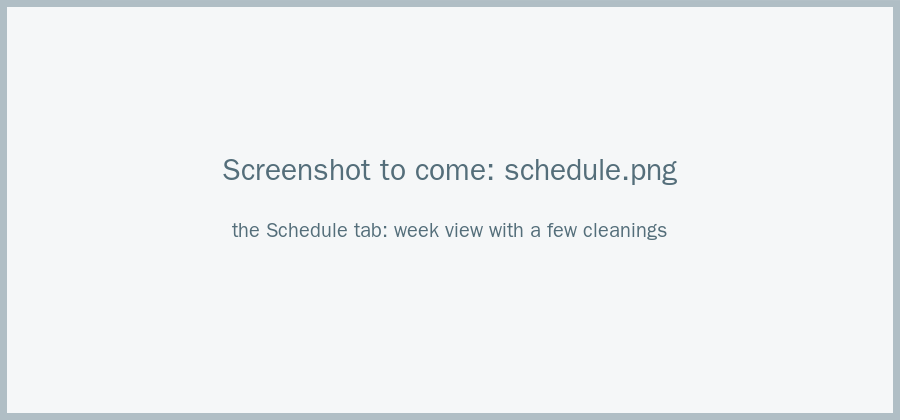

# Schedule

Valetudo's own timers: the robot runs them itself, even when QGIS is closed.

## Week view

Monday to Sunday, 6:00 to midnight, each scheduled cleaning as a block (grey when
off):

- **click** a block to select it, **double-click** it to edit it;
- **double-click an empty slot** to create a cleaning there;
- **drag a room group** (or a room) from the Clean tab and drop it on a day and time
  to schedule it.

## List

One line per cleaning: name, days, time, what. Tick it to turn it on or off;
double-click or **Edit…** to change it; **Run now** starts it at once.

## The editor

- Name, days and time.
- **Whole home** or **Selected rooms** (the same tree as the Clean tab, with your
  groups; optionally in the order ticked, and the number of passes).
- Fan speed, water usage and mode to apply first (*Unchanged* leaves them as they
  are).

Changes are saved on the robot at once, and also appear in Valetudo's own
interface.

## Tonight…

Cleans the ticked rooms (or the whole home) once, at the time you choose today, or
tomorrow if that time is past. It is a timer named "Once dd/MM HH:mm" that the
plugin deletes an hour after its start, the next time it connects.

!!! warning "Time zones and the robot's clock"
    Times are shown in local time; Valetudo stores them in UTC. After a change to or
    from summer time, a cleaning starts one hour off until it is saved again. The
    robot's clock must be right: see Valetudo's NTP settings.
