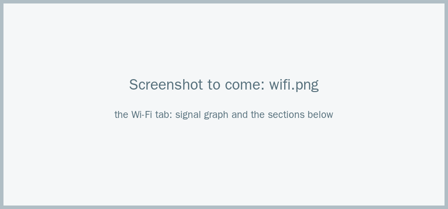

# Wi-Fi

The robot's Wi-Fi signal now, and maps of it across the home.

## Signal and thresholds

The signal now, with a graph of the last 10 minutes, and the three colour
thresholds (green, yellow, red from), used by the strip, the graph and the maps.

## Survey with QGIS open

**Record Wi-Fi survey** reads the robot's signal at regular intervals and stores it
as a point at the robot's position (layer *Wi-Fi survey*: `signal` in dBm,
`frequency`, `ssid`, `time`).

1. Start a cleaning and let the robot go everywhere.
2. Click the button again: the points are interpolated (IDW) into the *Wi-Fi signal
   (dBm)* raster, clipped to the rooms, coloured with the fixed thresholds — so two
   surveys can be compared.

Several recordings add to the same layer for a smoother map. **Build Wi-Fi map**
rebuilds it, from the selected points only if some are selected (e.g. one Wi-Fi
band). Every value (interval, minimum distance, cell size, IDW coefficient,
thresholds, opacity, clipping) is in the settings, tab *Wi-Fi survey*.

Once the project is saved, the points are kept in `wifi/robot_wifi.gpkg` and the
map in `wifi/robot_wifi_signal.tif`, next to the project.

## The other Wi-Fi networks

Robots that can scan (Valetudo's Wi-Fi scan, on most Dreame, Roborock, Viomi and
Midea robots) list every network they see, with its signal. During a survey, the
plugin asks for a scan every 15 s once the robot has moved, and adds a point per
network in *Wi-Fi networks seen* (`ssid`, `bssid` — one per access point or
band —, `signal`, `time`). **Scan Wi-Fi networks here** (Wi-Fi tab) does one scan
where the robot stands.

Filter the layer on a `bssid` to see where an access point or a repeater is heard,
or on an `ssid` for your neighbours' networks. Valetudo answers a scan within about
2 s, with the previous scan if a new one takes longer: a point may then be a few
seconds old. The networks seen are kept in `wifi/robot_wifi.gpkg` too.

!!! tip
    Check first in Valetudo's Swagger UI (`http://<robot>/swagger/`) that
    `WifiConfigurationCapability` returns a fresh `signal` at each call. If it is
    cached, use a longer reading interval.

## Survey recorded on the robot

So that QGIS does not have to stay open: see
[the Wi-Fi recorder on the robot](../extras/robot-recorder.md) (advanced tools).

## Maps built on a Raspberry Pi

A Pi can fetch each run and build its map by itself; **Load Wi-Fi map from the
Pi** brings the newest one (or the full map of all runs) into QGIS; the toolbar
button loads the one you chose last (*Latest run* or *Full map*, Wi-Fi tab). While
the Pi has no map of all runs yet, it loads the latest run instead. See
[Wi-Fi maps on a Raspberry Pi](../extras/pi-wifi-maps.md).
