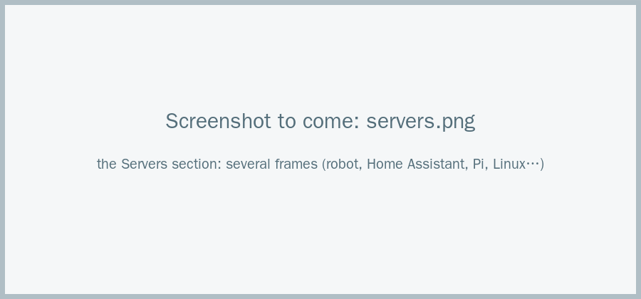
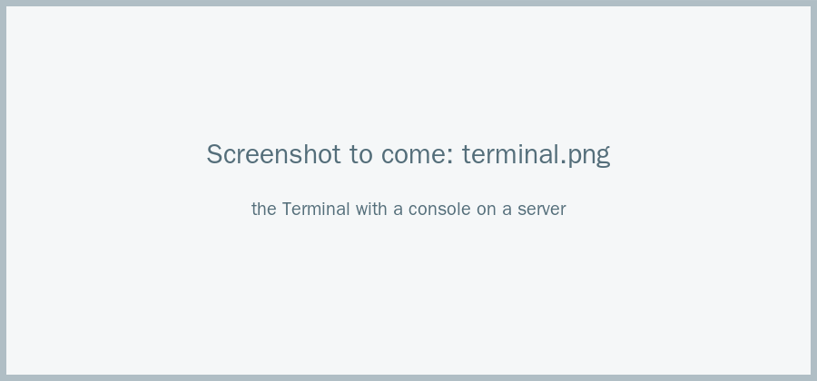

# Servers

The **🖥 Servers** section shows a frame per server of the settings, in their order,
the robot's where the robot in use is. **Refresh all**, at the right of the title,
reads every server again; each one also refreshes by itself while the panel is
visible. Clicking the status strip opens this section.

## What each frame shows

| Type | What you see | Read |
|---|---|---|
| **Valetudo robot** | connection, model, Valetudo version, Wi-Fi, address, its clock, uptime, state and battery | every 5 s / 30 s |
| **Raspberry Pi**, **Linux computer** | name and system, address, clock, uptime; load, memory, disk and temperature | over SSH, every 30 s |
| **Home Assistant** | version, home name and time zone, address, its clock, uptime (from the *Uptime* integration, if installed) | every minute |
| **Kodi** | version and system, address, uptime, CPU temperature; what is playing, with **⏸ / ▶** and **⏹** | every 5 s |
| **Windows computer** | whether its SSH (when its OpenSSH server is ticked), else RDP or VNC port answers | every 30 s |
| **Web service** | whether its address answers (any HTTP status) | every minute |

A clock more than 2 minutes off is shown in orange, with how far off, and listed by
the ⚠.

## Buttons

Each frame has up to four buttons, shown only where there is something to open
(hover them for the address or command):

- **⏻ Wake-on-LAN** wakes the machine from sleep or power-off, when its MAC address
  is set (see [Settings › Wake-on-LAN](settings.md#wake-on-lan)). The packet is
  broadcast on the local network; the frame checks the server again 30 s and 1 min
  later.
- **🌐 Web interface**, in your browser: Valetudo for the robot, Home Assistant (its
  arrow also opens the **Supervisor**, port 4327), Kodi's web interface, a web
  service, or the *Web address* you set for a computer (Cockpit, Uptime Kuma,
  Glances…).
- **🖥 Remote desktop** (VNC or RDP; its arrow chooses when both are set), see below.
- **>_ SSH** in your system's terminal. Its arrow also offers **Console in QGIS** and
  **Log in QGIS** (advanced tools).

Kodi and web services use the computer they *run on* (see
[Settings › Servers](settings.md#runs-on)).

### SSH

The terminal is the one named by the `TERMINAL` environment variable, else
`x-terminal-emulator` (Debian, MX Linux…), else the first known terminal found;
Terminal on macOS; Windows Terminal (or a console) on Windows. The window stays open
when the session ends, to read any error. With a password login, type it there.

### Remote desktop

The program is the one set in the settings (*Remote desktop programs*), else the
first found: Remmina, TigerVNC/TightVNC `vncviewer`, `xfreerdp` or KRDC on Linux;
`mstsc` or a VNC viewer on Windows; Screen Sharing or Microsoft Remote Desktop on
macOS.

With **Through SSH** (on by default for Linux computers and Pis), the plugin first
opens an encrypted SSH tunnel to the server, and the program connects through it:
the VNC or RDP server can stay closed to the network. The tunnel ends by itself when
you close the remote desktop.

## Terminal

*Console in QGIS* or *Log in QGIS* opens the **Terminal** in this section, on that
server, with a **Console | Log** switch; its **✕** closes it. Consoles and logs run
only while they are shown.

### Console

Type a command, press Enter: it runs on the server over SSH; its output appears
below, errors in red, with the exit code when it is not 0. `cd` carries over from
one command to the next (shown in the prompt); ↑ and ↓ recall previous commands.

It is not a full terminal: one command at a time, nothing can be typed into a
running command, and interactive programs (`vi`, `top`, `less`) do not work — use
e.g. `top -b -n 1`. Variables set with `export` do not carry over. **Stop** ends a
command that does not finish (e.g. `tail -f`).

### Log

Follows a log, last 200 lines then the new ones (errors in red, warnings in
orange); it reconnects by itself 10 s after the link drops.

| Server | Log |
|---|---|
| Robot | Valetudo's log, `/tmp/valetudo.log` |
| Raspberry Pi | `~/valetudo/collect.log`, the [Wi-Fi collector's](extras/pi-wifi-maps.md) log |
| Linux computer | the system log: `journalctl` where systemd runs, else `/var/log/syslog` (may need `root` or the `adm` group); or your own *Log command* |
| Home Assistant | `ha core logs -n 200 -f` by default (Home Assistant OS); e.g. `docker logs -f -n 200 homeassistant` for another installation |

*Scroll to new lines* keeps the newest line in view; untick it to read older lines
in peace. *Clear* empties the view (not the file).
