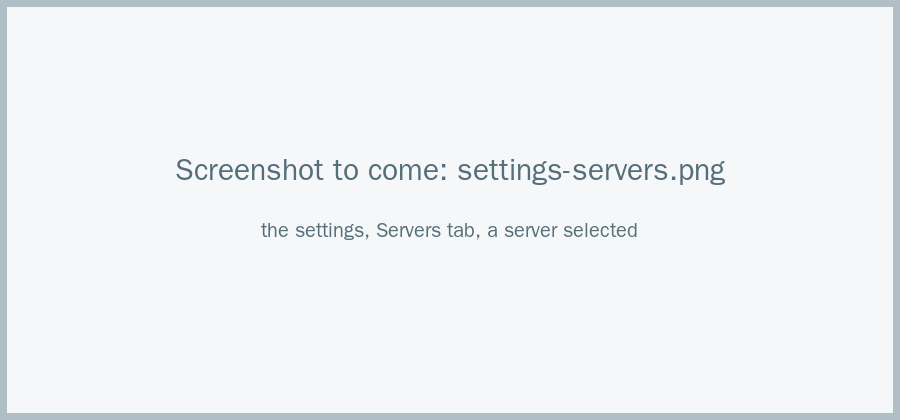

# Settings

*Settings › Options › DomotiQGIS*, or **⚙** in the panel. As on every Options page,
**OK** applies and **Cancel** saves nothing.

## Servers

The servers the plugin works with, in the order of the panel. There is none to
begin with.

- **Add** one of a type: *Valetudo robot*, *Raspberry Pi*, *Home Assistant*, *Kodi*,
  *Linux computer*, *Windows computer*, *Web service*.
- **⧉** duplicates the selected server (its tokens and passwords too), **－** removes
  it, **▲ ▼** move it.
- On the right: its **Name**, **Show in the status strip**, the fields of its type,
  and **Test connection**.
- With several robots, **Robot in use** picks the one the panel and the map work
  with.

### Fields by type

| Type | Fields |
|---|---|
| Valetudo robot | address; authentication (optional, if Valetudo's HTTP login is on); SSH user and port (for the reboot, console and log; `root`, 22) |
| Raspberry Pi | address; MAC address; SSH user (`pi`) and port; Wi-Fi maps folder; web address; remote desktop |
| Linux computer | address; MAC address; SSH user (`root`) and port; log command (empty: automatic); web address; remote desktop |
| Windows computer | address; MAC address; OpenSSH server (tick it if it runs one), SSH user and port; web address; remote desktop (RDP by default) |
| Home Assistant | address; runs on; MAC address; access token; SSH address, user (`root`), password and port; log command |
| Kodi | address; runs on; MAC address; username and password |
| Web service | address; runs on |

An SSH address can be typed with a user or port (`root@ha.lan:2222`): they are
taken from it.

### Runs on

Home Assistant, Kodi and web services can **run on** a Linux computer, a Pi or a
Windows computer of the list. Their address then takes that computer's host, with
their own port, and their SSH and remote desktop go to that computer.

### Wake-on-LAN

The **MAC address** of a machine (`aa:bb:cc:dd:ee:ff`; `-` or no separator are
fine too, shown in red until it is a valid one) adds a **Wake-on-LAN** button to its
frame. A server that *runs on* a computer of the list uses that computer's MAC
address when its own is empty. The machine must allow it: Wake-on-LAN on in its
BIOS/UEFI and on its network card (on Linux, `ethtool -s <card> wol g`), usually on
a wired connection.

### Remote desktop

For Pis, Linux and Windows computers: **VNC**, **RDP** or both, their ports
(5900, 3389), the user, and **Through SSH** (an encrypted tunnel; on by default
except for Windows). **Remote desktop programs**, under the form: the command to
use for VNC and for RDP, with `{host}`, `{port}`, `{user}` and `{userat}` (the user
and @, or nothing); empty uses the program found (shown in grey).

### Home Assistant

The token is a **long-lived access token**, created in Home Assistant on your
profile page (*Security › Long-lived access tokens*). Without it, the plugin can only
check that Home Assistant answers (*No token*); the Home section and the sensors
need it.

For the console and log on Home Assistant OS, install the **Terminal & SSH** add-on,
set its port in the add-on's *Network* settings, then paste your public key
(`~/.ssh/id_ed25519.pub`) in its `authorized_keys` option, or set a password there and
in the plugin's *SSH password* field (OpenSSH 8.4 or newer). Without an SSH address,
Home Assistant's own host is used, as `root`.

### Kodi

In Kodi: *Settings › Services › Control*, turn on **Allow remote control via HTTP**
and set a username and password (port 8080 by default).

!!! note "Tokens and passwords"
    They are stored encrypted in the QGIS authentication database, which may ask for
    its master password. They never appear on a command line or in a file.

## Robot

- **General**: live tracking refresh; the **robot project** (the QGIS project the
  robot's map, history and Wi-Fi maps are kept next to); when QGIS starts without a
  project, open the robot project and show the robot on the map; **advanced
  tools**; *Edit room groups…*.
- **Camera**: stream URL (empty: `tcp://<robot>:8555`), ffmpeg path, video width;
  *Record the camera whenever the robot runs* (on by default, see [Camera](robot/camera.md)).
- **Notifications**: warn when a dock tank is empty, full or missing.
- **History**: record the robot's outings.

## Wi-Fi survey

Reading interval, minimum distance between points, maximum age of the robot's
position, map cell size, IDW coefficient, the three thresholds (bad, fair, good),
map opacity, clipping to the rooms. See [Wi-Fi](robot/wifi.md).

## UI configuration

- **Order of the robot's tabs**: drag them, or ▲ ▼; *Default order* (Clean,
  Schedule, History, Camera, Wi-Fi, Maintenance).
- **Toolbar**: the commands the DomotiQGIS toolbar shows: the panel, *Show on map*,
  *Clean everything*, *Dock*, *Clean a zone…*, *Go to…*, *Settings…*, and the map
  tools (right column; shown while *Show on map* is on, the advanced ones only with
  *Advanced tools*).
- **Status strip**: servers as a coloured dot instead of an *On the air* / *Off the
  air* label.
- **Map**: *Keep the robot in view while Show on map is on* recentres the map when
  the robot nears the edge. Off by default: the map stays where you put it.

## Backup

- **Save now** writes the whole configuration to a new file,
  `valetudo_qgis_config_YYYYMMDD_HHMMSS.json` (all the settings, the servers, the room
  groups, the panel's choices), in a folder of your choice (by default
  `valetudo_backups` in the QGIS profile folder). It first applies the values on
  screen, as OK does.
- **Load selected…** (or a double-click) and **Load a file…** replace the
  configuration at once, after a confirmation.
- Tokens and passwords stay out of the files unless you tick **Include tokens and
  passwords**: they are then written in clear (the file is made readable by you only).
- **Reset config** goes back to the defaults (no servers, no tokens, no room groups)
  after saving a backup, so it can be undone.

## About

What the plugin does, its author and licence, links, and the system it runs on (QGIS,
Qt, Python, whether `ffmpeg` and `ssh` are found), with **Copy system information**
for a bug report. Also in the panel's **⋮ › About…**.
